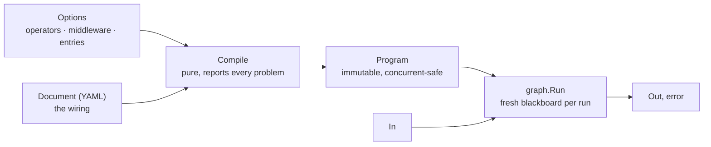
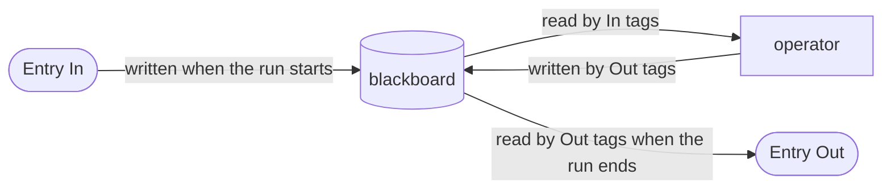
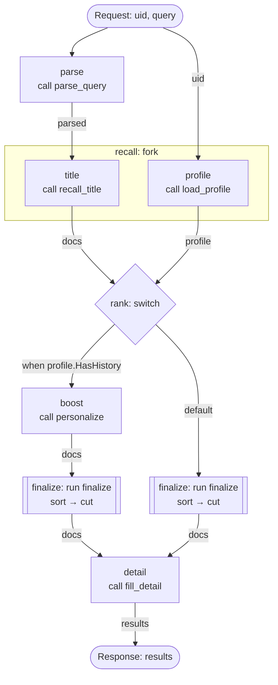
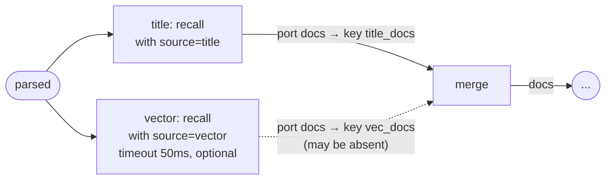

# go-graph

English | [简体中文](README_zh.md)

**go-graph** is an in-process operator scheduler for Go. Operators are plain Go functions, the topology lives in a YAML document, and `Compile` checks the whole data flow before anything runs. A document with a problem, hot-reloaded or not, is rejected as a whole instead of going live with the error.

> **Status:** pre-release. There is no tagged version yet and the API may still change.

## Features

- **Operators are plain functions**: `func(ctx, In) (Out, error)`, where `In` and `Out` are structs tagged with blackboard keys. Unit-test an operator by calling it.
- **Declarative topology**: sequence, fork, switch, subgraphs, conditions and middleware are described in YAML; conditions are [CEL](https://cel.dev) expressions, type-checked at compile time.
- **Compile-time data-flow checking**: every read must follow a write, keys that may be absent must be read as `graph.Maybe[T]`, key types must agree, and entry outputs must be produced on every path. All problems are reported at once, with line and column.
- **Failures leave nothing behind**: the writes of timed-out work, tolerated failures, failed retry attempts and failed fork branches are discarded, never half-applied.
- **Typed entry points**: `Entry[In, Out]` runs a graph with Go types for both input and output.
- **Compilation without side effects**: `Compile(src, opts...)` reads no files and uses no global state; it returns an immutable, concurrency-safe `*Program`. Hot reload is an atomic pointer swap in your code.
- **Small API**: `Compile` to compile, `Run` to run; everything else is an option passed to `Compile`.

## Contents

- [Installation](#installation)
- [Quick start](#quick-start)
- [Concepts](#concepts)
- [Basic usage](#basic-usage)
  - [Write operators](#1-write-operators) · [Passing data](#2-passing-data) · [Register and compile](#3-register-and-compile) · [Run an entry](#4-run-an-entry) · [Write the document](#5-write-the-document)
- [Advanced usage](#advanced-usage)
  - [Task attributes](#task-attributes) · [Keys that may be absent](#keys-that-may-be-absent-maybe) · [Ports and key renaming](#ports-and-key-renaming) · [Task configuration](#task-configuration)
  - [Conditional tasks](#conditional-tasks-if) · [Timeouts and tolerated failures](#timeouts-and-tolerated-failures) · [Background tasks](#background-tasks-and-drain)
  - [Middleware](#middleware-wrap) · [Observability](#observability-wrapcalls) · [Testing](#testing) · [Splitting documents](#splitting-documents-import) · [Hot reload](#hot-reload) · [Code generation](#code-generation-graphgen-optional)
- [Compile-time checks](#compile-time-checks)
- [Errors](#errors)
- [Guarantees and conventions](#guarantees-and-conventions)
- [Performance](#performance)
- [Limitations](#limitations)
- [Examples](#examples)
- [Project layout](#project-layout)
- [Development](#development)

## Installation

Requires Go 1.26.3 or later.

```sh
go get github.com/tra4less/go-graph
```

```go
import graph "github.com/tra4less/go-graph/graph"
```

## Quick start

One operator, one entry, one graph:

```go
package main

import (
	"context"
	"fmt"

	graph "github.com/tra4less/go-graph/graph"
)

// An operator reads "name" and writes "greeting": the graph tags are blackboard keys.
type GreetIn struct {
	Name string `graph:"name"`
}

type GreetOut struct {
	Greeting string `graph:"greeting"`
}

func Greet(_ context.Context, in GreetIn) (GreetOut, error) {
	return GreetOut{Greeting: "hello, " + in.Name}, nil
}

// The entry: what the caller passes in and gets back, with the same tag rules.
type Request struct {
	Name string `graph:"name"`
}

type Response struct {
	Greeting string `graph:"greeting"`
}

var Hello = graph.NewEntry[Request, Response]("hello") // "hello" names a graph in the document

const doc = `
graphs:
  hello:
    do:
      - greet:
          call: greet
`

func main() {
	prog, err := graph.Compile([]byte(doc), Hello, graph.Op("greet", Greet))
	if err != nil {
		panic(err)
	}
	resp, err := graph.Run(context.Background(), prog, Hello, Request{Name: "go"})
	if err != nil {
		panic(err)
	}
	fmt.Println(resp.Greeting) // hello, go
}
```

A mistake in the document is caught by `Compile`, not at run time. Add a task that calls an operator nobody registered:

```yaml
      - bye:
          call: bye
```

```
graph: 1 compile problem(s):
  7:9: hello/bye: unknown operator "bye"
```

For a fuller example, see [examples/search](examples/search/): query parsing, multi-source recall, merge, rerank, per-user ranking and detail fill. `go test ./examples/search -run Example -v` prints the output of every step.

## Concepts

| Concept | What it is | Where |
|---|---|---|
| **Operator** | A function that does the work: `func(ctx, In) (Out, error)` | Go, registered with `graph.Op` |
| **Middleware** | A function wrapped around tasks, onion-style: `func(ctx, graph.Wrap[In]) error` | Go, `graph.Middleware`; used by `wrap:` or `graph.WrapCalls` |
| **Entry** | Declares a runnable graph and its typed input and output; `graph.Run(ctx, prog, entry, in)` runs it | Go, `graph.NewEntry` |
| **Option** | Everything passed to `Compile`: operators, middleware, entries, `Import`, `Override`, `WrapCalls`. There is no global registry | Go code; `Import` carries document content |
| **Document** | A YAML document; `graphs:` defines named graphs, `import:` uses other documents | Can be hot-reloaded |
| **Task** | One step of a graph, written `name: {...}` | YAML |
| **Program** | The result of `Compile`: immutable, safe for concurrent use | `graph.Compile` |
| **Blackboard** | The only way data moves within a run: values read and written by key name | The `graph` struct tags |
| **Overlay** | A temporary layer of writes on the blackboard, merged when its task succeeds and dropped when it fails | Managed by the library |



## Basic usage

### 1. Write operators

```go
type RecallIn struct {
	Query *Query `graph:"parsed"` // read from the blackboard; Compile fails if nothing wrote it before
}

type DocsOut struct {
	Docs []Doc `graph:"docs"` // written to the blackboard
}

func RecallTitle(ctx context.Context, in RecallIn) (DocsOut, error) { /* ... */ }
```

- `In` and `Out` are structs. Every exported field carries `graph:"key"`; unexported fields are ignored. `struct{}` reads or writes nothing.
- Within one entry's graph (subgraphs included) a key has a single Go type.
- An operator is called concurrently by many runs, so it must be safe for concurrent use and respond to `ctx` cancellation.
- An operator with dependencies is a method; register the method value: `graph.Op("fill_detail", details.Fill)`.

Optional inputs, per-task configuration and key renaming are covered in [Advanced usage](#advanced-usage).

### 2. Passing data

Within a run, data moves only through the blackboard:



- A key is the name in a tag. Every `Run` gets a fresh blackboard, so runs never see each other's data.
- An operator reads the values on the blackboard when it starts. A key it reads must be guaranteed to be written before, or `Compile` fails; read keys that may be absent as `Maybe` (see [Keys that may be absent](#keys-that-may-be-absent-maybe)).
- nil is a value: writing a nil pointer still counts as a write. To say "maybe not there", use `Maybe`, not nil.

Which writes later tasks see:

| Construct | Writes visible to later tasks |
|---|---|
| sequence (`do`) | every earlier task's; a later write to a key replaces an earlier one |
| `fork` | none between branches; after all succeed, every branch's |
| `switch` | the matched case's |
| a failed `optional` or `timeout` task | none: its writes are dropped |
| a task skipped by `if` | none: it did not run |
| a `background` task | none: its outputs are never written back |
| middleware `In` | the values from before the wrapped tasks start |

Each kind of data has its place:

| Data | Where | Notes |
|---|---|---|
| dependencies (RPC clients, config, loggers) | the operator's method receiver | bound at registration, shared by every run |
| per-run data (the query, recalled documents) | the blackboard | read and written by key, checked at compile time, dropped on failure |
| a request-scoped shared object that several operators modify | a pointer key in the Entry's In | the library checks the key, not what happens inside the object: changes to it are neither isolated nor rolled back, and when fork branches change it concurrently the object must be safe for concurrent use |
| values that cross layers (trace ids, request ids) | `ctx` | available to operators and middleware |

### 3. Register and compile

Operators, middleware and entries are all `graph.Option`s. Build them once at startup, in the package that owns the operators:

```go
func Options(d Deps) ([]graph.Option, error) {
	if d.Details == nil { // a method value on a nil receiver panics only when called
		return nil, errors.New("search: Deps.Details is nil")
	}
	return []graph.Option{
		Search, // the entry
		graph.Op("parse_query", ParseQuery),
		graph.Op("recall_title", RecallTitle),
		graph.Op("load_profile", LoadProfile),
		graph.Op("personalize", Personalize),
		graph.Op("sort_by_score", SortByScore),
		graph.Op("top_n", TopN),
		graph.Op("fill_detail", d.Details.Fill),
	}, nil
}

prog, err := graph.Compile(doc, opts...)
```

Keep `opts` and compile every new document with it. If the options themselves are wrong (a bad tag, a duplicate name), `Compile` returns a plain `error`, which means a bug in the code; if the document is wrong, it returns a `*graph.CompileError`.

### 4. Run an entry

```go
type Request struct {
	UID   string `graph:"uid"`
	Query string `graph:"query"`
}

type Response struct {
	Results []Result `graph:"results"` // Compile checks every path writes it
}

var Search = graph.NewEntry[Request, Response]("search")

resp, err := graph.Run(ctx, prog, Search, Request{UID: "u1", Query: "go"})
```

- Input fields are set before the graph starts, so every task can read them.
- Output fields must be written on every path through the graph. A hot-reloaded document that drops the producing task is rejected.
- On error, `resp` holds whatever is on the blackboard at that point and `err` is a `*graph.TaskError` whose `Path` names the failed task.
- A Program runs only the `Entry` values it was compiled with; any other `Entry`, even one with the same name, gets an error.

### 5. Write the document

```yaml
graphs:
  search:                         # has an Entry: runnable
    do:
      - parse:
          call: parse_query       # query -> parsed
      - recall:
          fork:                   # independent lookups: run them concurrently
            - title:
                call: recall_title    # parsed -> docs
            - profile:
                call: load_profile    # uid -> profile
      - rank:
          switch:
            - personal:           # users with history: boost what they like first
                when: "profile.HasHistory"
                do:
                  - boost:
                      call: personalize   # docs, profile -> docs
                  - finalize:
                      run: finalize
            - default:            # everyone else
                do:
                  - finalize:
                      run: finalize
      - detail:
          call: fill_detail       # docs -> results

  finalize:                       # no Entry: a subgraph, inlined wherever it is run
    do:
      - sort:
          call: sort_by_score     # docs -> docs
      - cut:
          call: top_n             # docs -> docs
```

The same graph as a diagram; edge labels are the keys that flow:



Each task is `name: {...}` with exactly one of:

| Kind | Effect |
|---|---|
| `call: op` | Call an operator |
| `do: [tasks]` | Run tasks in order; the first failure fails the group |
| `fork: [tasks]` | Run branches concurrently; when all succeed their writes are kept. The first failure cancels the rest and fails the fork at once, without waiting for them |
| `switch: [cases]` | Run the first case whose `when` holds |
| `run: graph` | Inline another graph: of this document, or `alias.graph` of an [imported](#splitting-documents-import) one |

The attributes that change how a task runs (`if`, `timeout`, `optional`, `background`, `wrap`) and the call-only fields `with`, `in` and `out` are described in [Advanced usage](#advanced-usage).

Task names are unique within their list, cannot contain `/`, and form task paths such as `search/recall/title`, which appear in `TaskError.Path` and `Wrap.Path`. YAML anchors and aliases are expanded before compilation.

A few rules to know:

- **fork**: branches run on separate overlays and cannot see each other's writes; two branches may not write the same key (a compile error).
- **switch**: cases are evaluated top to bottom; `when` is a [CEL](https://cel.dev) expression over keys guaranteed at that point. The case named `default` is the fallback: it has no `when` and must be last; every other case needs one. If nothing matches and there is no `default`, the task fails; to skip instead, add an empty `default` (`do: []`). An error while evaluating a `when` is the switch task's own failure, so `optional` on it ignores the error.
- **run**: a graph without an Entry is a subgraph, the way to reuse steps such as `finalize` above. It is inlined at every call site: task paths continue below the call site (e.g. `search/rank/default/finalize/sort`), it shares the caller's blackboard, and it is checked against the data flow there. Unused subgraphs and recursion are compile errors. To share subgraphs across documents, see [Splitting documents](#splitting-documents-import).

## Advanced usage

### Task attributes

| Attribute | Applies to | Effect |
|---|---|---|
| `if: "CEL"` | any task | Skip the task when the condition is false; see [conditional tasks](#conditional-tasks-if) |
| `timeout: 50ms` | any task | Fail with `graph.ErrTimeout` when exceeded; see [timeouts](#timeouts-and-tolerated-failures) |
| `optional: true` | any task | Tolerate the task's own failure; its writes are dropped |
| `background: true` | any task | Run alongside the rest of the graph; `Run` waits for it before returning (see [background tasks](#background-tasks-and-drain)) |
| `wrap: [mw, ...]` | `do`, and a graph itself | Run the tasks inside middleware; see [middleware](#middleware-wrap) |
| `with: {...}` | `call` | Task config for the operator; see [task configuration](#task-configuration) |
| `in:` / `out:` | `call` | Connect operator ports to other keys; see [ports](#ports-and-key-renaming) |

### Keys that may be absent: `Maybe`

`Compile` tracks, at every point of the graph, which keys are guaranteed to be set and which may be absent. Reading a key that may be absent requires a `Maybe[T]` field:

```go
type MergeIn struct {
	Primary []Doc              `graph:"primary"`
	Extra   graph.Maybe[[]Doc] `graph:"extra"` // written by an optional task: may be absent
}

func Merge(_ context.Context, in MergeIn) (DocsOut, error) {
	docs := slices.Clone(in.Primary)
	if in.Extra.OK {
		docs = append(docs, in.Extra.V...)
	}
	return DocsOut{Docs: docs}, nil
}
```

The same type marks entry inputs the caller may omit (`Hint graph.Maybe[string]`) and outputs that are produced on some paths only. A `Maybe` field in an operator's `Out` is written only when `OK` is true; build one with `graph.Some(v)`.

When a key is guaranteed and when it may be absent:

| Source | Afterwards the key is |
|---|---|
| Non-`Maybe` entry input / a task that succeeded | guaranteed |
| `Maybe` entry input / a `Maybe` output field | may be absent |
| A **new** key written by an `optional` task or a task with `if` | may be absent |
| A key already guaranteed, rewritten by an `optional` task or a task with `if` | still guaranteed (the old value is kept) |
| Written by some switch cases only | may be absent |
| Written by every case (without `default`, "no match" fails rather than skipping) | guaranteed |
| Written by any fork branch | guaranteed |
| Written by a `background` task | never written back |

### Ports and key renaming

A tag names the operator's **port**. By default a port binds the key of the same name; a task can connect it elsewhere with `in:` / `out:` (`port: key`). Keep graph-level names out of the tags: an operator should not know that its input is "the vector recall". This is how one operator runs twice in a graph:

```yaml
- recall:
    fork:
      - title:
          call: recall
          with:
            source: title
          out:
            docs: title_docs      # port docs -> key title_docs
      - vector:
          call: recall
          with:
            source: vector
          out:
            docs: vec_docs
          timeout: 50ms
          optional: true
- merge:
    call: merge
    in:
      primary: title_docs         # port primary <- key title_docs
      extra: vec_docs
```



### Task configuration

```go
type RecallIn struct {
	Cfg   RecallCfg `graph:",with"` // receives the task's with:
	Query *Query    `graph:"parsed"`
}

type RecallCfg struct {
	Source string `yaml:"source"`
	Limit  int    `yaml:"limit"`
}

func (c RecallCfg) Validate() error { // optional; runs at compile time
	if c.Source != "title" && c.Source != "vector" {
		return fmt.Errorf("source must be title or vector, got %q", c.Source)
	}
	return nil
}
```

An operator's `In` may have one `graph:",with"` field of any type (pointers included). At compile time the task's `with:` is decoded into it strictly (unknown fields are errors) and then validated, if the type has a `Validate() error` method. A task without `with:` gets the zero value, still validated. Panics in decoding or `Validate` become compile problems, so a hot-reloaded document cannot crash the process.

### Conditional tasks: `if`

```yaml
- rewrite:
    call: rewrite_query         # parsed -> parsed: expand short queries
    if: "size(parsed.Terms) < 2"
- personalize:                  # skip a whole group: anonymous users get no profile
    if: "uid != ''"
    do:
      - profile:
          call: load_profile    # uid -> profile
      - boost:
          call: personalize     # docs, profile -> docs
```

After this, `parsed` and `docs` are still guaranteed, because the skippable tasks only rewrite existing values; `profile`, written only inside the group, may be absent.

The condition is evaluated as the task starts. When false the task does not run and its middleware is not called. Conditions follow the same rules as `when`: they must be boolean and may only reference keys guaranteed at that point. Struct fields use Go names (`profile.HasHistory`), renamable with a `cel:"name"` tag; a key whose value is a nil pointer is an error, not `false`; a nil pointer in a nested field reads as the zero value. An evaluation error is the task's own failure, so `optional` tolerates it.

### Timeouts and tolerated failures

```yaml
- recall:
    fork:
      - title:
          call: recall_title
      - vector:                 # slow and nice to have
          call: recall_vector
          timeout: 50ms         # give up after 50ms...
          optional: true        # ...and carry on without it
```

- `timeout` fails the task with `graph.ErrTimeout`, which wraps `context.DeadlineExceeded`. Operators see it as `context.Cause(ctx)`, so they can tell their own timeout from the caller's cancellation. Work still running at the deadline is abandoned and its writes are discarded.
- `optional` tolerates the task's own failure (an error, a timeout or a panic) and drops its writes. Cancellation by the caller is not the task's own failure and is never tolerated.

### Background tasks and `Drain`

```yaml
- log:
    call: search_log
    background: true
```

A `background` task runs on a snapshot of the blackboard taken when it starts, and the main path continues without waiting; `Run` returns only after every background task of the run has finished. Its outputs are never written back, so later tasks cannot see them, and it cannot be `optional`. Its failure does not fail the run: it is logged with `slog.Default().ErrorContext`, carrying the run's context values (such as trace ids). It is cancelled with the run's context, not with the task that started it, so a background task inside a task with a `timeout` keeps running after that timeout.

`Program.Drain(ctx)` covers what can outlive a run: work abandoned by a `timeout`, and fork branches cancelled after a sibling failed, when that work ignores `ctx`. Call it at shutdown. With a context that is already done it does not block: it returns `nil` if the Program is idle and the context's error otherwise.

### Middleware: `wrap`

```yaml
- detail:
    wrap:                       # the first entry is outermost
      - slow_log:               # log when the wrapped tasks take longer than this
          threshold: 100ms
      - retry:                  # re-run it when it fails
          attempts: 3
          backoff: 20ms
    do:
      - fill:
          call: fill_detail     # an idempotent read: safe to retry
```

An entry is a middleware name, or `name: {config}` when it takes config. A graph can have `wrap:` next to its `do:`, wrapping the whole graph; `Path` is then the path of the graph at its call site.

Retry is provided by [ext/retry](ext/retry/): register it once with `graph.Middleware("retry", retry.Retry)`.

| Config | Default | Meaning |
|---|---|---|
| `attempts` | 3 | Total runs, the first included |
| `backoff` | 0 | Wait before the second attempt; doubles after each failure |
| `maxBackoff` | none | Cap on the wait |

It does not retry panics, and stops as soon as the context is done (the caller cancelled or a `timeout` expired). `retry.When(retryable)` builds a variant that retries only the errors you choose. Retry only tasks that are safe to repeat.

Writing your own middleware takes one function. `slow_log` above reads a blackboard key and has a config:

```go
type SlowLogIn struct {
	Cfg struct {
		Threshold time.Duration `yaml:"threshold"`
	} `graph:",with"`              // the wrap: entry's config
	UID string `graph:"uid"`       // read from the blackboard before the wrapped tasks start
}

func SlowLog(ctx context.Context, w graph.Wrap[SlowLogIn]) error {
	start := time.Now()
	err := w.Next(ctx) // run the wrapped tasks (here: retry around fill)
	if d := time.Since(start); d > w.In.Cfg.Threshold {
		slog.WarnContext(ctx, "slow tasks", "path", w.Path, "uid", w.In.UID, "cost", d, "err", err)
	}
	return err
}

graph.Middleware("slow_log", SlowLog)
```

`Wrap` carries everything about one invocation: `Path` is the path of the wrapped tasks; `Op` is the operator, set only for middleware added by `WrapCalls`; `In` holds the keys read before they start, plus the config, checked like an operator's `In`; `Next` runs the wrapped tasks. New fields may be added, so construct it with field names.

- Each `Next` call runs the wrapped tasks on a fresh overlay; only a successful attempt is committed, so retries leave nothing behind.
- The outcome is that of the last `Next` call: middleware can observe, retry or reject, but not turn a failure into success; use `optional` for that.
- Returning `nil` without calling `Next` fails the task. `Next` must be called before the middleware returns; late attempts are discarded.

### Observability: `WrapCalls`

go-graph itself records nothing about a run: no traces, no metrics. Observability comes from middleware. `graph.WrapCalls` puts registered middleware around every call task of the document, without editing the document:

```go
opts = append(opts,
	graph.Middleware("span", Span),
	graph.WrapCalls("span"),
)

func Span(ctx context.Context, w graph.Wrap[struct{}]) error {
	ctx, span := tracer.Start(ctx, w.Path, trace.WithAttributes(attribute.String("op", w.Op)))
	defer span.End()
	return w.Next(ctx) // the operator, and the RPCs it makes, run under this span
}
```

The middleware sits inside the task's timeout and overlay, directly around the operator, so it measures the operator itself. Its rules are those of `wrap:`. Give `WrapCalls` at most once; it costs about 1 µs per call task.

### Testing

Operators and middleware are plain functions; test them without the library:

```go
out, err := search.Recall(ctx, search.RecallIn{Cfg: search.RecallCfg{Source: "title", Limit: 5}, Query: q})

err := retry.Retry(ctx, graph.Wrap[retry.Input]{
	In:   retry.Input{Cfg: retry.Config{Attempts: 3}},
	Next: flaky, // a func(context.Context) error double
})
```

For whole-graph tests, `graph.Override` replaces registered operators or middleware with doubles. Its position among the options does not matter. A double must have the same name and the same `In` and `Out` types, so export those types for operators you want to replace.

```go
fake := graph.Override(graph.Op("load_profile", func(ctx context.Context, in search.ProfileIn) (search.ProfileOut, error) {
	return search.ProfileOut{Profile: &search.Profile{HasHistory: true}}, nil
}))
prog, err := graph.Compile(search.DefaultDoc(), append(opts, fake)...)
```

To assert which branch ran or which task was skipped, record calls with a `WrapCalls` middleware.

### Splitting documents: `import`

A document can use graphs of other documents. It lists them under `import:`, one alias per module, and `Import` options supply their content. `Compile` still takes one document, the root, and never reads files: where the bytes come from (`embed`, disk, a config center) is up to you.

```yaml
# root document, given to Compile
import:
  rank: search/rank             # alias: module id
graphs:
  search:
    do:
      - recall:
          call: recall
      - order:
          run: rank.default      # graph "default" of module search/rank
```

```yaml
# module search/rank
graphs:
  default:
    do:
      - score:
          run: _score
  _score:                        # starts with _: private to this document
    do:
      - sort:
          call: sort_by_score
```

```go
prog, err := graph.Compile(rootDoc,
	graph.Import("search/rank", rankDoc),
	Search, graph.Op("recall", Recall), graph.Op("sort_by_score", SortByScore),
)
```

- **Module ids are opaque.** `Compile` only matches the ids in `import:` lists against `Import` options; a path and a config-center key work equally. Renaming a file changes nothing as long as the id stays.
- **Names are scoped per document.** A graph's own graphs are referenced by name, an imported module's as `alias.graph`; graph names cannot contain `.`, and aliases cannot contain `.` or `/`. Graphs whose names start with `_` are private: only their own document can run them.
- **Entries resolve in the root document**: `NewEntry[...]("search")` for a graph of the root, `NewEntry[...]("rank.default")` for a public graph of a module the root imports. A root that only lists imports is a valid manifest.
- **Imports are transitive.** An imported document may import further modules, from the same set of `Import` options. A module is parsed once however many documents import it; import cycles are a compile error.
- **Mismatches are errors both ways**: an import nobody provides, an `Import` nobody imports, an alias nobody uses. Each id is given once.
- **Nothing else changes.** Imported graphs are inlined at every `run` like local subgraphs, share the caller's blackboard and are checked against the data flow at each call site. Task paths follow the call site, not the document. An imported module is treated as a library: its public graphs may stay unused, but its private ones must be run by their own document.
- **Problems name their module**: `search/rank:8:9: search/order/score/sort: unknown operator "nope"` (the path is the call site's, the position is in the module); problems of the root document have no prefix. `Problem.Module` holds the id.

On hot reload, rebuild the `Import` options from the new content and compile the whole set again: all documents switch together or not at all.

### Hot reload

The library only compiles; swapping is yours:

```go
var cur atomic.Pointer[graph.Program]

func reload(src []byte, imports []graph.Option) error {
	p, err := graph.Compile(src, append(slices.Clip(opts), imports...)...) // opts: built once from code; imports: from the new documents
	if err != nil {
		return err // rejected: the old Program keeps serving
	}
	old := cur.Swap(p) // runs in flight keep the Program they started with
	retire(old)        // abandoned work may still run on it: Drain it at shutdown
	return nil
}
```

[examples/search/engine.go](examples/search/engine.go) is a complete version: it keeps replaced Programs, drops the idle ones on each reload with `Drain` on a done context, and drains all of them at shutdown.

### Code generation: graphgen (optional)

Instead of writing `Options` by hand, declare the operators in `operators.yaml` and let [graphgen](cmd/graphgen/) generate it. The generated function also checks method receivers at startup and reports every nil one.

```yaml
x-search: &search github.com/tra4less/go-graph/examples/search   # x- keys are ignored: anchors

operators:
  parse_query:
    package: *search
    func: ParseQuery            # package-level function
  fill_detail:
    package: *search
    func: (*Details).Fill       # method: *Details becomes a Receivers field

middleware:
  retry:
    package: github.com/tra4less/go-graph/ext/retry
    func: Retry

entries:
  - package: *search
    var: Search
```

```go
//go:generate go run github.com/tra4less/go-graph/cmd/graphgen@<version> -in operators.yaml -out operators_gen.go
```

```go
opts, err := searchgen.Options(searchgen.Receivers{Details: details})
```

The generated file declares `Options` and `Receivers`; put it in its own package (like `examples/searchgen`) so it never clashes with hand-written code. `package` is a full import path. Every symbol is loaded and type-checked; all problems are reported with positions in `operators.yaml`. `-check` verifies the generated file is up to date without writing it, for CI. graphgen is a separate Go module, so `golang.org/x/tools` never enters your build. See [examples/searchgen](examples/searchgen/).

## Compile-time checks

`Compile` never stops at the first problem; each is reported with its YAML position and task path.

| Area | Rejected |
|---|---|
| References | unknown operators, middleware or graphs; private graphs run from another document |
| Imports | an import not provided; an `Import` no document imports; an unused alias; a module imported twice by one document; import cycles |
| Fields | unknown fields; `with:` decoded strictly; panics in decoding or `Validate` |
| Data flow | reads of keys nothing wrote before; non-`Maybe` reads of keys that may be absent; one key with two types; middleware reading keys not guaranteed before the wrapped tasks start; two `out` ports into one key |
| CEL (`if`, `when`) | syntax and type errors; non-boolean results; keys not guaranteed at that point; two Go struct types with the same CEL name |
| Entries | outputs not written on every path (`Maybe`: on no path); an Entry without its graph, or on a private graph; a root graph with neither Entry nor `run` |
| Structure | recursive subgraphs; `background` with `optional`; empty `fork` / `switch`; fork branches writing the same key; a misplaced or conditional `default` |
| Size | more than 10,000 tasks after inlining |

## Errors

| Error | When |
|---|---|
| `*graph.CompileError` | A document is invalid; `Problems` lists every problem, each with `Module` (empty for the root document), `Path`, `Line`, `Column` |
| plain `error` from `Compile` | The options are invalid, which is a bug in Go code; no document is parsed |
| `*graph.TaskError` | A task failed at run time; `Path` and `Err` say which task and why. `Op` names the operator of a failed call; `Middleware` is set when the failure is a middleware's own. After a panic, `Panic` and `Stack` hold the recovered value and the stack |
| `graph.ErrTimeout` | A task exceeded its own `timeout` (use `errors.Is`) |

Failures that only a bug produces (middleware not calling `Next`, a switch with no match, running an unregistered Entry) are returned with a clear message, but their error variables are not exported, since no code should branch on them.

## Guarantees and conventions

- **Values on the blackboard are treated as immutable.** Isolation applies to writing keys; mutating the object behind a pointer is not undone. To change a value, read it, copy, and write it back; for an object several operators must modify, see [Passing data](#2-passing-data).
- **Sequential writes replace earlier ones**; concurrent writes (fork branches) are a compile error.
- **Operators must be safe for concurrent use and honour `ctx`.** An operator that ignores `ctx` is abandoned on timeout but runs to completion.
- **User code cannot crash the process**: panics become a `*TaskError` at run time and a compile problem at compile time.

## Performance

Measured with `go test -bench . ./graph` (Intel Xeon Gold 6271C):

| Benchmark | Time | Allocations |
|---|---|---|
| 10 sequential calls | ~3 µs | 27 |
| 10 sequential calls, one `WrapCalls` middleware | ~11 µs | 137 |
| fork of 4 | ~18 µs | 46 |
| one task with `timeout` | ~10 µs | 22 |
| switch | ~1.3 µs | 11 |
| compile a 200-task document | ~1.6 ms | — |

## Limitations

- No loops yet; the compiler leaves room for a structured `loop: { while, max, do }`.
- No streaming output.
- No process-wide hooks: observability is per Program, through middleware.
- Fork branches cannot depend on each other.

## Examples

| Example | Shows |
|---|---|
| [examples/search](examples/search/) | Every feature except `import`, on a search request; hand-written options, hot reload, `Drain`, tests |
| [examples/searchgen](examples/searchgen/) | The same options generated by graphgen |

## Project layout

```
.
├── graph/          the library (package graph)
├── ext/            optional components the core does not depend on
│   └── retry/      retry middleware
├── cmd/graphgen/   optional code generator (separate module)
└── examples/       runnable examples
```

A component under `ext/` lives in this module if it needs only `graph` and the standard library, in its own module otherwise.

## Development

The repository holds two modules, the root (`graph/` and the examples) and `cmd/graphgen`, joined by `go.work`.

```sh
go test -race ./...
(cd cmd/graphgen && go test -race ./...)
(cd cmd/graphgen && go run . -in ../../examples/searchgen/operators.yaml -out ../../examples/searchgen/operators_gen.go -check)
```

## License

Not yet chosen.
