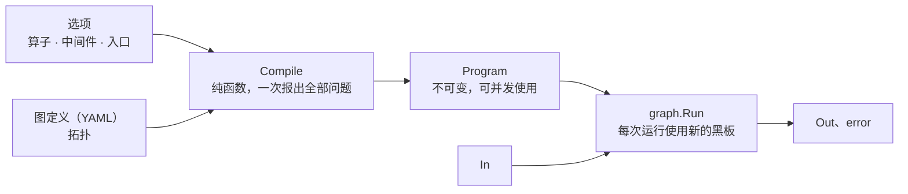
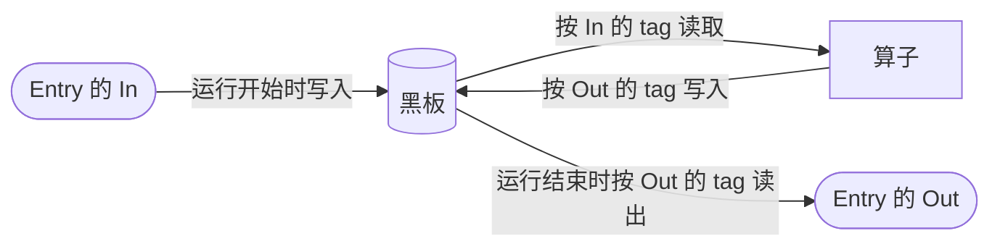
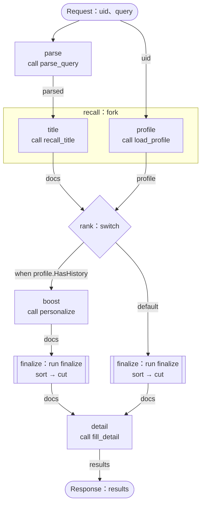
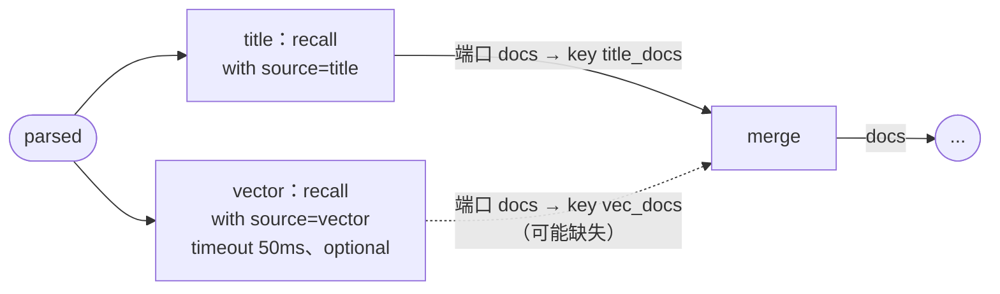

# go-graph

[English](README.md) | 简体中文

**go-graph** 是一个进程内的 Go 算子编排库：算子写成普通的 Go 函数，拓扑写在 YAML 里；每次运行有一块黑板（blackboard），算子之间只通过它按 key 名传递数据。`Compile` 在运行前检查整张图的数据流，有问题的图定义（包括热更新下发的）会编译失败、整体不生效，不会带着错误上线。

> **状态：** 未发布。还没有版本号，接口仍可能变化。

## 特性

- **算子就是普通函数**：签名为 `func(ctx, In) (Out, error)`，`In`、`Out` 是用 tag 标注黑板 key 的 struct，单测时直接调用。
- **声明式拓扑**：串行、并发、分支、子图、条件和中间件都在 YAML 里描述；条件用 [CEL](https://cel.dev) 表达式，编译时做类型检查。
- **编译期数据流检查**：读取前必须有写入；可能缺失的 key 必须用 `graph.Maybe[T]` 读取；同一个 key 只能有一种类型；入口的出参必须在每条路径上产出。所有问题一次性列出，并附行列号。
- **失败不留脏数据**：超时被放弃的任务、被忽略的失败、重试中失败的尝试、失败的 fork 分支，写入都会被丢弃，不会留下写了一半的数据。
- **入口带类型**：`Entry[In, Out]` 的入参和出参都是 Go 类型。
- **编译没有副作用**：`Compile(src, opts...)` 不读文件、不依赖全局状态，返回不可变、可并发使用的 `*Program`；热更新只需原子替换一个指针。
- **接口精简**：编译用 `Compile`，运行用 `Run`，其余都是传给 `Compile` 的选项。

## 目录

- [安装](#安装)
- [快速开始](#快速开始)
- [概念](#概念)
- [基础用法](#基础用法)
  - [编写算子](#1-编写算子) · [数据传递](#2-数据传递) · [注册并编译](#3-注册并编译) · [运行入口](#4-运行入口) · [编写图定义](#5-编写图定义)
- [高级用法](#高级用法)
  - [任务属性](#任务属性) · [可能缺失的 key](#可能缺失的-keymaybe) · [端口与改名](#端口与改名) · [任务配置](#任务配置)
  - [条件任务](#条件任务if) · [超时与容错](#超时与容错) · [后台任务](#后台任务与-drain)
  - [中间件](#中间件wrap) · [可观测性](#可观测性wrapcalls) · [测试](#测试) · [拆分图定义](#拆分图定义import) · [热更新](#热更新) · [代码生成](#代码生成graphgen可选)
- [编译期检查](#编译期检查)
- [错误](#错误)
- [使用约定](#使用约定)
- [性能](#性能)
- [限制](#限制)
- [示例](#示例)
- [项目结构](#项目结构)
- [开发](#开发)

## 安装

需要 Go 1.26.3 或更高版本。

```sh
go get github.com/tra4less/go-graph
```

```go
import graph "github.com/tra4less/go-graph/graph"
```

## 快速开始

下面的例子包含一个算子、一个入口和一张图：

```go
package main

import (
	"context"
	"fmt"

	graph "github.com/tra4less/go-graph/graph"
)

// 算子：读 name，写 greeting。graph tag 就是黑板上的 key。
type GreetIn struct {
	Name string `graph:"name"`
}

type GreetOut struct {
	Greeting string `graph:"greeting"`
}

func Greet(_ context.Context, in GreetIn) (GreetOut, error) {
	return GreetOut{Greeting: "hello, " + in.Name}, nil
}

// 入口：调用方传入和拿回的数据，tag 规则和算子相同。
type Request struct {
	Name string `graph:"name"`
}

type Response struct {
	Greeting string `graph:"greeting"`
}

var Hello = graph.NewEntry[Request, Response]("hello") // "hello" 是图定义里的图名

const doc = `
graphs:
  hello:
    do:
      - greet:
          call: greet
`

func main() {
	prog, err := graph.Compile([]byte(doc), Hello, graph.Op("greet", Greet))
	if err != nil {
		panic(err)
	}
	resp, err := graph.Run(context.Background(), prog, Hello, Request{Name: "go"})
	if err != nil {
		panic(err)
	}
	fmt.Println(resp.Greeting) // hello, go
}
```

图定义里的错误在 `Compile` 阶段就会报出，不必等到运行时。例如加一个调用未注册算子的任务：

```yaml
      - bye:
          call: bye
```

```
graph: 1 compile problem(s):
  7:9: hello/bye: unknown operator "bye"
```

更完整的例子见 [examples/search](examples/search/)，覆盖查询解析、多路召回、合并、精排、按用户分流排序和补全详情。运行 `go test ./examples/search -run Example -v` 可以看到每一步的输出。

## 概念

| 概念 | 是什么 | 在哪里 |
|---|---|---|
| **算子**（operator） | 执行具体逻辑的函数：`func(ctx, In) (Out, error)` | Go，用 `graph.Op` 注册 |
| **中间件**（middleware） | 包在一段任务外层的函数（洋葱模型）：`func(ctx, graph.Wrap[In]) error` | Go，用 `graph.Middleware` 注册；由 `wrap:` 或 `graph.WrapCalls` 使用 |
| **入口**（Entry） | 声明一张调用方可以运行的图及其入参、出参类型；用 `graph.Run(ctx, prog, entry, in)` 运行 | Go，`graph.NewEntry` |
| **选项**（Option） | 传给 `Compile` 的全部内容：算子、中间件、入口、`Import`、`Override`、`WrapCalls`。没有全局注册表 | Go 代码；其中 `Import` 携带图定义的内容 |
| **图定义** | 一份 YAML，`graphs:` 下定义若干张有名字的图，可以用 `import:` 引用其他图定义 | 可以热更新 |
| **任务**（task） | 图中的一个步骤，写作 `名字: {...}` | YAML |
| **Program** | 编译结果：不可变，可并发使用 | `graph.Compile` |
| **黑板**（blackboard） | 一次运行中传递数据的唯一方式，按 key 名读写 | 各 struct 的 `graph` tag |
| **overlay** | 黑板上的一层临时写入：所属任务成功才合并进黑板，失败就整层丢弃 | 由库内部管理 |



## 基础用法

### 1. 编写算子

```go
type RecallIn struct {
	Query *Query `graph:"parsed"` // 从黑板读取；之前没有任务写过这个 key 时，Compile 报错
}

type DocsOut struct {
	Docs []Doc `graph:"docs"` // 写入黑板
}

func RecallTitle(ctx context.Context, in RecallIn) (DocsOut, error) { /* ... */ }
```

- `In` 和 `Out` 都是 struct，每个导出字段都要带 `graph:"key"`，未导出字段会被忽略；`struct{}` 表示不读或不写任何 key。
- 在同一个入口的图里（包括展开的子图），一个 key 只能对应一种 Go 类型。
- 同一个算子会被多次运行并发调用，因此必须并发安全，并响应 `ctx` 的取消。
- 需要依赖的算子写成方法，注册时传方法值：`graph.Op("fill_detail", details.Fill)`。

可选输入、任务配置和 key 改名，见[高级用法](#高级用法)。

### 2. 数据传递

一次运行中，数据只通过黑板传递：



- key 名就是 tag 里写的名字。每次 `Run` 使用一块新的黑板，不同运行之间互相看不到。
- 算子读到的是它开始执行时黑板上的值。读取的 key 必须在此之前一定已写入，否则 `Compile` 报错；可能缺失的 key 用 `Maybe` 读取，见[可能缺失的 key](#可能缺失的-keymaybe)。
- nil 是合法的值：写入 nil 指针也算已写入。要表达"可能没有"，用 `Maybe`，不要用 nil。

后续任务能看到哪些写入：

| 结构 | 后续任务看到的写入 |
|---|---|
| 顺序执行（`do`） | 前面所有任务的写入；同一个 key 后写的覆盖先写的 |
| `fork` | 分支之间互相看不到；全部成功后，后续任务能看到所有分支的写入 |
| `switch` | 命中的那个 case 的写入 |
| 失败的 `optional` 或 `timeout` 任务 | 看不到，它的写入被丢弃 |
| 被 `if` 跳过的任务 | 看不到，它没有执行 |
| `background` 任务 | 看不到，它的输出不写回黑板 |
| 中间件的 `In` | 读到的是被包住的任务开始前的值 |

不同的数据放在不同的地方：

| 数据 | 放在哪 | 说明 |
|---|---|---|
| 依赖（RPC 客户端、配置、日志等） | 算子的方法接收者 | 注册时绑定，所有运行共用 |
| 一次运行的数据（查询、召回结果等） | 黑板 | 按 key 读写，有编译期检查，失败时写入被丢弃 |
| 请求级的共享对象（需要多个算子共同修改的上下文） | Entry 入参里的一个指针 key | 框架只检查这个 key 本身，不检查对象内部的读写，也不隔离、不回滚对对象的修改；fork 分支并发修改时，对象自己要保证并发安全 |
| 跨层传递的值（trace id、请求 id 等） | `ctx` | 算子和中间件都能拿到 |

### 3. 注册并编译

算子、中间件和入口都是 `graph.Option`。建议在算子所在的包里提供一个函数，启动时调用一次，构造全部选项：

```go
func Options(d Deps) ([]graph.Option, error) {
	if d.Details == nil { // 方法值的接收者为 nil 时，要到调用时才会 panic，所以提前检查
		return nil, errors.New("search: Deps.Details is nil")
	}
	return []graph.Option{
		Search, // 入口
		graph.Op("parse_query", ParseQuery),
		graph.Op("recall_title", RecallTitle),
		graph.Op("load_profile", LoadProfile),
		graph.Op("personalize", Personalize),
		graph.Op("sort_by_score", SortByScore),
		graph.Op("top_n", TopN),
		graph.Op("fill_detail", d.Details.Fill),
	}, nil
}

prog, err := graph.Compile(doc, opts...)
```

`opts` 保存下来，之后每份新的图定义都用它编译。选项本身有误（例如 tag 写错、名字重复）时，`Compile` 返回普通 `error`，说明是代码的 bug；图定义有问题时，返回 `*graph.CompileError`。

### 4. 运行入口

```go
type Request struct {
	UID   string `graph:"uid"`
	Query string `graph:"query"`
}

type Response struct {
	Results []Result `graph:"results"` // Compile 检查每条路径都写了它
}

var Search = graph.NewEntry[Request, Response]("search")

resp, err := graph.Run(ctx, prog, Search, Request{UID: "u1", Query: "go"})
```

- 入参的字段在图开始执行前写入黑板，所有任务都能读取。
- 出参的字段必须在图的每条路径上都有写入；热更新下发的图定义如果删掉了产出它的任务，会编译失败。
- 出错时，`resp` 里是黑板上已有的值，`err` 是 `*graph.TaskError`，其中 `Path` 指出失败的任务。
- 一个 Program 只能运行编译时传入的那些 `Entry`；用其他 `Entry` 调用（即使图名相同）会返回错误。

### 5. 编写图定义

```yaml
graphs:
  search:                         # 有 Entry，是可运行的入口图
    do:
      - parse:
          call: parse_query       # query -> parsed
      - recall:
          fork:                   # 两次查询互不依赖，并发执行
            - title:
                call: recall_title    # parsed -> docs
            - profile:
                call: load_profile    # uid -> profile
      - rank:
          switch:
            - personal:           # 有历史行为的用户：先按偏好加权
                when: "profile.HasHistory"
                do:
                  - boost:
                      call: personalize   # docs, profile -> docs
                  - finalize:
                      run: finalize
            - default:            # 其他用户
                do:
                  - finalize:
                      run: finalize
      - detail:
          call: fill_detail       # docs -> results

  finalize:                       # 没有 Entry，是子图，在每个 run 它的地方原地展开
    do:
      - sort:
          call: sort_by_score     # docs -> docs
      - cut:
          call: top_n             # docs -> docs
```

这张图的结构如下，边上标注的是传递的 key：



每个任务写作 `名字: {...}`，并且必须恰好包含下面一种写法：

| 写法 | 作用 |
|---|---|
| `call: 算子名` | 调用一个算子 |
| `do: [任务...]` | 按顺序执行；任一任务失败，整组失败 |
| `fork: [任务...]` | 并发执行各分支，全部成功后保留写入；任一分支失败时立即取消其余分支并让 fork 失败，不等它们结束 |
| `switch: [case...]` | 执行第一个 `when` 成立的 case |
| `run: 图名` | 把另一张图原地展开：同一份图定义里的图，或[导入](#拆分图定义import)模块的 `别名.图名` |

`if`、`timeout`、`optional`、`background`、`wrap` 这些改变执行方式的属性，以及只能用在 call 上的 `with`、`in`、`out`，见[高级用法](#高级用法)。

同一层列表里的任务名不能重复，也不能包含 `/`。任务名逐层拼成任务路径（如 `search/recall/title`），出现在 `TaskError.Path` 和 `Wrap.Path` 中。YAML 的锚点和别名会在编译前展开。

几条需要了解的规则：

- **fork**：各分支在独立的 overlay 上执行，看不到彼此的写入；两个分支写同一个 key 会编译报错。
- **switch**：case 从上到下依次求值，`when` 是 [CEL](https://cel.dev) 表达式，只能引用此处一定已写入的 key。名为 `default` 的 case 是兜底分支，不写 `when`，必须放在最后；其他 case 都必须写 `when`。没有 case 命中、也没有 `default` 时任务失败；想直接跳过，就加一个空的 `default`（`do: []`）。`when` 求值出错算 switch 任务自身的失败，因此可以被它上面的 `optional` 忽略。
- **run**：没有 Entry 的图是子图，用来复用一段步骤，比如上面的 `finalize`。子图在每个调用处原地展开：任务路径接在调用处后面（如 `search/rank/default/finalize/sort`），与调用方共用黑板，并按调用处的数据流分别检查。没有被引用的子图和递归引用都会编译报错。在多份图定义之间复用子图，见[拆分图定义](#拆分图定义import)。

## 高级用法

### 任务属性

| 属性 | 适用于 | 作用 |
|---|---|---|
| `if: "CEL"` | 所有任务 | 条件为 false 时跳过，见[条件任务](#条件任务if) |
| `timeout: 50ms` | 所有任务 | 超时后任务失败，错误为 `graph.ErrTimeout`，见[超时与容错](#超时与容错) |
| `optional: true` | 所有任务 | 任务自身失败时继续执行，它的写入被丢弃 |
| `background: true` | 所有任务 | 与后续任务并行执行，`Run` 返回前会等它结束，见[后台任务](#后台任务与-drain) |
| `wrap: [中间件...]` | `do`，以及图本身 | 用中间件包住这些任务，见[中间件](#中间件wrap) |
| `with: {...}` | `call` | 算子的任务配置，见[任务配置](#任务配置) |
| `in:` / `out:` | `call` | 把算子的端口接到其他 key，见[端口与改名](#端口与改名) |

### 可能缺失的 key：`Maybe`

`Compile` 会跟踪图中每个位置上哪些 key 一定已写入、哪些可能缺失。读取可能缺失的 key 时，字段类型必须是 `Maybe[T]`：

```go
type MergeIn struct {
	Primary []Doc              `graph:"primary"`
	Extra   graph.Maybe[[]Doc] `graph:"extra"` // 由 optional 任务写入，可能缺失
}

func Merge(_ context.Context, in MergeIn) (DocsOut, error) {
	docs := slices.Clone(in.Primary)
	if in.Extra.OK {
		docs = append(docs, in.Extra.V...)
	}
	return DocsOut{Docs: docs}, nil
}
```

`Maybe` 也用于入口中调用方可以不传的入参（如 `Hint graph.Maybe[string]`），以及只在部分路径上产出的出参。算子 `Out` 里的 `Maybe` 字段只在 `OK` 为 true 时写入，可以用 `graph.Some(v)` 构造。

一个 key 在某个位置是一定存在还是可能缺失，按下表判断：

| 情况 | 此后该 key |
|---|---|
| 入口的非 `Maybe` 入参 / 成功的任务写入 | 一定存在 |
| 入口的 `Maybe` 入参 / `Maybe` 出参字段 | 可能缺失 |
| `optional` 任务或带 `if` 的任务**新写**的 key | 可能缺失 |
| 此前已一定存在、被 `optional` 或带 `if` 的任务改写的 key | 仍然一定存在（保留原值） |
| 只有部分 switch case 写入 | 可能缺失 |
| 所有 case 都写入（没有 `default` 也成立，因为未命中会失败而不是跳过） | 一定存在 |
| 任一 fork 分支写入 | 一定存在 |
| `background` 任务的输出 | 不写入黑板 |

### 端口与改名

tag 写的是算子的端口名。端口默认对应同名的 key，任务可以用 `in:` / `out:` 改接到其他 key，写法是 `端口: key`。tag 里只写算子自身的语义，不写图层面的名字，算子不需要知道它的输入是"向量召回的结果"。同一个算子在图里出现多次时，就靠改名来区分：

```yaml
- recall:
    fork:
      - title:
          call: recall
          with:
            source: title
          out:
            docs: title_docs      # 端口 docs -> key title_docs
      - vector:
          call: recall
          with:
            source: vector
          out:
            docs: vec_docs
          timeout: 50ms
          optional: true
- merge:
    call: merge
    in:
      primary: title_docs         # 端口 primary <- key title_docs
      extra: vec_docs
```



### 任务配置

```go
type RecallIn struct {
	Cfg   RecallCfg `graph:",with"` // 接收任务的 with:
	Query *Query    `graph:"parsed"`
}

type RecallCfg struct {
	Source string `yaml:"source"`
	Limit  int    `yaml:"limit"`
}

func (c RecallCfg) Validate() error { // 可选；编译时调用
	if c.Source != "title" && c.Source != "vector" {
		return fmt.Errorf("source must be title or vector, got %q", c.Source)
	}
	return nil
}
```

算子的 `In` 里最多有一个 `graph:",with"` 字段，类型不限（也可以是指针）。编译时，任务的 `with:` 会严格解码到这个字段，出现未知字段即报错；类型实现了 `Validate() error` 时，解码后再调用它校验。没写 `with:` 的任务得到零值，同样会校验。解码或 `Validate` 过程中的 panic 会转成一条编译错误，热更新下发的图定义不会导致进程崩溃。

### 条件任务：`if`

```yaml
- rewrite:
    call: rewrite_query         # parsed -> parsed：对短查询做扩展
    if: "size(parsed.Terms) < 2"
- personalize:                  # 跳过整组任务：匿名用户没有画像
    if: "uid != ''"
    do:
      - profile:
          call: load_profile    # uid -> profile
      - boost:
          call: personalize     # docs, profile -> docs
```

在这之后，`parsed` 和 `docs` 仍然一定存在，因为这两个任务只是改写已有的值；只在组内写入的 `profile` 则变为可能缺失。

条件在任务开始时求值，结果为 false 时任务不执行，任务上的中间件也不会被调用。条件的规则与 `when` 相同：必须返回 bool，只能引用此处一定已写入的 key。struct 字段用 Go 字段名访问（`profile.HasHistory`），可以用 `cel:"name"` tag 改名。key 的值本身是 nil 指针时会报错，而不是当作 false；嵌套字段里的 nil 指针按零值处理。求值出错算作任务自身的失败，因此可以被 `optional` 忽略。

### 超时与容错

```yaml
- recall:
    fork:
      - title:
          call: recall_title
      - vector:                 # 较慢，且不是必需的
          call: recall_vector
          timeout: 50ms         # 50ms 内没返回就放弃
          optional: true        # 失败了也继续执行
```

- `timeout` 到期后任务失败，错误为 `graph.ErrTimeout`（它包装了 `context.DeadlineExceeded`）。算子通过 `context.Cause(ctx)` 拿到的也是它，可以据此区分是自己超时还是调用方取消。到期时仍在运行的工作会被放弃，写入被丢弃。
- `optional` 忽略任务自身的失败（错误、超时或 panic），并丢弃它的写入。调用方取消 ctx 不算任务自身的失败，不会被忽略。

### 后台任务与 `Drain`

```yaml
- log:
    call: search_log
    background: true
```

`background` 任务基于启动时黑板的快照运行，主流程不等它，继续往下执行；`Run` 会等本次运行的所有后台任务结束后才返回。后台任务的输出不写回黑板，后续任务看不到；它也不能和 `optional` 一起用。它失败不会导致请求失败，只会用 `slog.Default().ErrorContext` 记一条日志，日志带有本次运行 ctx 中的值（如 traceid）。后台任务随整次运行的 ctx 取消，而不是随启动它的那段任务取消：放在带 `timeout` 的任务里的后台任务，timeout 到期后仍会继续运行。

`Program.Drain(ctx)` 用来等待运行结束后仍可能存活的工作：超时被放弃的工作，以及因兄弟分支失败而被取消、但没有响应 `ctx` 的 fork 分支。在停机前调用。传入已经结束的 ctx 时，`Drain` 不会阻塞：Program 空闲时返回 `nil`，否则返回 ctx 的错误。

### 中间件：`wrap`

```yaml
- detail:
    wrap:                       # 第一项在最外层
      - slow_log:               # 耗时超过阈值时记日志
          threshold: 100ms
      - retry:                  # 失败时重试
          attempts: 3
          backoff: 20ms
    do:
      - fill:
          call: fill_detail     # 幂等的读操作，可以重试
```

每一项写中间件名，需要配置时写成 `名字: {配置}`。图本身也可以在 `do:` 旁边写 `wrap:`，包住整张图，此时 `Path` 是这张图在调用处的路径。

重试中间件由 [ext/retry](ext/retry/) 提供，用 `graph.Middleware("retry", retry.Retry)` 注册后即可在 `wrap:` 里使用。

| 配置 | 默认值 | 含义 |
|---|---|---|
| `attempts` | 3 | 总执行次数（含第一次） |
| `backoff` | 0 | 首次重试前的等待时间，之后每次翻倍 |
| `maxBackoff` | 不限 | 等待时间的上限 |

panic 不会重试；ctx 结束（调用方取消或 `timeout` 到期）后立即停止。用 `retry.When(retryable)` 可以构造只重试特定错误的版本。重试只应用在可以安全重复执行的任务上。

自定义中间件就是一个函数。上面的 `slow_log` 既读取黑板上的 key，也接收配置：

```go
type SlowLogIn struct {
	Cfg struct {
		Threshold time.Duration `yaml:"threshold"`
	} `graph:",with"`              // wrap: 里这一项的配置
	UID string `graph:"uid"`       // 被包住的任务开始前从黑板读取
}

func SlowLog(ctx context.Context, w graph.Wrap[SlowLogIn]) error {
	start := time.Now()
	err := w.Next(ctx) // 执行被包住的部分（这里是套了 retry 的 fill）
	if d := time.Since(start); d > w.In.Cfg.Threshold {
		slog.WarnContext(ctx, "slow tasks", "path", w.Path, "uid", w.In.UID, "cost", d, "err", err)
	}
	return err
}

graph.Middleware("slow_log", SlowLog)
```

`Wrap` 包含一次调用的全部信息：`Path` 是被包住部分的路径；`Op` 是算子名，只有 `WrapCalls` 加上的中间件才有值；`In` 是开始前读到的 key 和配置，检查规则与算子的 `In` 相同；`Next` 用来执行被包住的部分。`Wrap` 以后可能增加字段，构造时请写明字段名。

- 每次调用 `Next` 都在新的 overlay 上执行，只有成功的那次会被提交，所以重试不会留下脏写入。
- 成败以最后一次 `Next` 的结果为准：中间件可以观察、重试或拒绝，但不能把失败改成成功；需要容错请用 `optional`。
- 中间件没有调用 `Next` 就返回 `nil` 时，任务失败。`Next` 必须在中间件返回前调用，返回之后再调用的结果一律被丢弃。

### 可观测性：`WrapCalls`

go-graph 本身不记录执行过程，不产生 trace，也不产生指标；观测通过中间件实现。`graph.WrapCalls` 把已注册的中间件套到图定义中的每个 call 任务上，无需修改图定义：

```go
opts = append(opts,
	graph.Middleware("span", Span),
	graph.WrapCalls("span"),
)

func Span(ctx context.Context, w graph.Wrap[struct{}]) error {
	ctx, span := tracer.Start(ctx, w.Path, trace.WithAttributes(attribute.String("op", w.Op)))
	defer span.End()
	return w.Next(ctx) // 算子以及它发出的 RPC 都挂在这个 span 下
}
```

这层中间件位于任务的 timeout 和 overlay 之内、紧贴算子，因此测到的就是算子本身的耗时。其余规则与 `wrap:` 相同。`WrapCalls` 只能传一次，每个 call 任务大约增加 1 µs 开销。

### 测试

算子和中间件都是普通函数，可以脱离 go-graph 直接测试：

```go
out, err := search.Recall(ctx, search.RecallIn{Cfg: search.RecallCfg{Source: "title", Limit: 5}, Query: q})

err := retry.Retry(ctx, graph.Wrap[retry.Input]{
	In:   retry.Input{Cfg: retry.Config{Attempts: 3}},
	Next: flaky, // 测试替身，类型为 func(context.Context) error
})
```

测试整张图时，用 `graph.Override` 把已注册的算子或中间件替换成测试替身（mock）。`Override` 放在选项列表的任何位置效果都一样；测试替身必须同名，且 `In`、`Out` 类型相同，所以需要被替换的算子要导出它的 In / Out 类型。

```go
fake := graph.Override(graph.Op("load_profile", func(ctx context.Context, in search.ProfileIn) (search.ProfileOut, error) {
	return search.ProfileOut{Profile: &search.Profile{HasHistory: true}}, nil
}))
prog, err := graph.Compile(search.DefaultDoc(), append(opts, fake)...)
```

如果要断言走了哪个分支、哪个任务被跳过，可以用 `WrapCalls` 挂一个记录调用的中间件。

### 拆分图定义：`import`

一份图定义可以使用其他图定义里的图：在 `import:` 中为每个模块起一个别名，内容通过 `Import` 选项提供。`Compile` 仍然只接收一份图定义（根图定义），并且不读取文件，内容从哪里来（`embed`、磁盘或配置中心）由调用方决定。

```yaml
# 根图定义，传给 Compile
import:
  rank: search/rank             # 别名: 模块 ID
graphs:
  search:
    do:
      - recall:
          call: recall
      - order:
          run: rank.default      # 模块 search/rank 里的图 default
```

```yaml
# 模块 search/rank
graphs:
  default:
    do:
      - score:
          run: _score
  _score:                        # 以 _ 开头：仅本图定义可见
    do:
      - sort:
          call: sort_by_score
```

```go
prog, err := graph.Compile(rootDoc,
	graph.Import("search/rank", rankDoc),
	Search, graph.Op("recall", Recall), graph.Op("sort_by_score", SortByScore),
)
```

- **库不解析模块 ID 的含义**：`Compile` 只用它把 `import:` 中的声明和 `Import` 选项对应起来，用文件路径或配置中心的 key 都可以。只要 ID 不变，文件改名或移动目录都不受影响。
- **名字的作用域是单份图定义**：引用同一份图定义里的图直接写图名，引用导入模块的图写 `别名.图名`，因此图名中不能包含 `.`，别名也不能包含 `.` 或 `/`。以 `_` 开头的图是私有的，只能被所在的图定义 run。
- **Entry 在根图定义中解析**：根图定义自己的图写 `NewEntry[...]("search")`，根图定义所导入模块中的公开图写 `NewEntry[...]("rank.default")`。根图定义可以只有 `import:`、不定义图，只用来汇总入口。
- **导入可以传递**：被导入的图定义还可以导入其他模块，内容同样从这组 `Import` 中取。同一个模块无论被多少份图定义导入，都只解析一次；导入成环会编译报错。
- **声明与提供必须一一对应**：声明了导入但没有提供、提供了 `Import` 但没有任何图定义导入、别名未被使用，都会报错。同一个 ID 只能提供一次。
- **其他规则不变**：导入的图与本地子图一样，在每个 `run` 处原地展开，与调用方共用黑板，并按调用处的数据流分别检查。任务路径取决于调用位置，与图写在哪份图定义里无关。被导入的模块相当于一个库：它的公开图可以不被当前 Program 使用，但私有图必须被所在的图定义 run。
- **报错带模块 ID**：例如 `search/rank:8:9: search/order/score/sort: unknown operator "nope"`，其中任务路径是调用处的路径，行列号指向模块的图定义。根图定义中的问题不带前缀。`Problem.Module` 字段即模块 ID。

热更新时，用新内容重新构造 `Import` 选项，与根图定义一起重新编译：所有图定义要么一起生效，要么都不生效。

### 热更新

库只负责编译，替换由调用方完成：

```go
var cur atomic.Pointer[graph.Program]

func reload(src []byte, imports []graph.Option) error {
	p, err := graph.Compile(src, append(slices.Clip(opts), imports...)...) // opts 在启动时构造一次；imports 用新的图定义内容构造
	if err != nil {
		return err // 编译失败：旧 Program 继续服务
	}
	old := cur.Swap(p) // 正在执行的请求继续使用原来的 Program
	retire(old)        // 旧 Program 上可能还有被放弃的工作，停机时需要 Drain
	return nil
}
```

完整实现见 [examples/search/engine.go](examples/search/engine.go)：它保留被换下的 Program，每次热更新时用已结束的 ctx 调用 `Drain`，清理已经空闲的；停机时再把剩下的全部 Drain。

### 代码生成：graphgen（可选）

如果不想手写 `Options`，可以在 `operators.yaml` 中声明算子，由 [graphgen](graphgen/) 生成代码。生成的函数会在启动时检查方法接收者，一次列出所有为 nil 的接收者。

```yaml
x-search: &search github.com/tra4less/go-graph/examples/search   # 以 x- 开头的字段会被忽略，可用来定义锚点

operators:
  parse_query:
    package: *search
    func: ParseQuery            # 包级函数
  fill_detail:
    package: *search
    func: (*Details).Fill       # 方法：*Details 会成为 Receivers 的字段

middleware:
  retry:
    package: github.com/tra4less/go-graph/ext/retry
    func: Retry

entries:
  - package: *search
    var: Search
```

```go
//go:generate go run github.com/tra4less/go-graph/cmd/graphgen@<version> -in operators.yaml -out operators_gen.go
```

```go
opts, err := searchgen.Options(searchgen.Receivers{Details: details})
```

生成的文件会声明 `Options` 和 `Receivers`，建议放在单独的包里（如 `examples/searchgen`），避免和手写代码重名。`package` 要写完整的 import 路径。graphgen 会加载每个符号并做类型检查，所有问题带 `operators.yaml` 中的行列号一次报出。`-check` 只检查生成的文件是否最新，不写文件，适合在 CI 中使用。graphgen 是独立的 Go module，`golang.org/x/tools` 不会进入你的依赖。详见 [examples/searchgen](examples/searchgen/)。

## 编译期检查

`Compile` 遇到问题不会立即停止，而是收集全部问题一起报告，每个问题都带 YAML 位置和任务路径。

| 类别 | 会报错的情况 |
|---|---|
| 引用 | 算子、中间件或图不存在；从别的图定义 run 私有图 |
| 导入 | 声明的导入没有提供；`Import` 没有任何图定义导入；别名没人用；同一份图定义把一个模块导入两次；导入成环 |
| 字段 | 未知字段；`with:` 严格解码；解码或 `Validate` 时 panic |
| 数据流 | 读取的 key 之前没有任务写入；可能缺失的 key 没用 `Maybe` 读取；同一个 key 有两种类型；中间件读取的 key 在被包住的任务开始前不一定存在；两个 `out` 端口写同一个 key |
| CEL（`if`、`when`） | 语法和类型错误；返回值不是 bool；引用的 key 在此处不一定存在；两个 Go struct 类型在 CEL 里撞名 |
| 入口 | 出参没在每条路径上写入（`Maybe` 出参：没有任何路径写入）；Entry 没有对应的图，或指向私有图；根图定义中既没有 Entry、也没有被 `run` 的图 |
| 结构 | 子图递归；`background` 配了 `optional`；`fork` / `switch` 为空；fork 的两个分支写同一个 key；`default` 位置不对或写了 `when` |
| 规模 | 子图展开后超过 10,000 个任务 |

## 错误

| 错误 | 什么时候 |
|---|---|
| `*graph.CompileError` | 图定义有问题；`Problems` 列出全部问题，每条带 `Module`（根图定义为空）、`Path`、`Line`、`Column` |
| `Compile` 返回的普通 `error` | 选项有误，属于 Go 代码的 bug；此时不会解析图定义 |
| `*graph.TaskError` | 运行时某个任务失败；`Path`、`Err` 说明是哪个任务、什么原因。`Op` 是失败的 call 任务的算子名；失败出在中间件自身时，`Middleware` 是中间件名。panic 时 `Panic`、`Stack` 记录 panic 的值和调用栈 |
| `graph.ErrTimeout` | 任务超过了自己的 `timeout`（用 `errors.Is` 判断） |

只有代码或图定义有误时才会出现的失败（中间件没调用 `Next`、switch 没有命中、用未注册的 Entry 运行）会返回清晰的错误信息，但对应的错误变量不导出，因为不应该有代码依据它们做分支判断。

## 使用约定

- **黑板上的值应视为不可变**：隔离机制只覆盖对 key 的写入，原地修改指针指向的对象无法撤销。需要修改时，先读出、复制一份，再写回；确实要被多个算子共同修改的对象，见[数据传递](#2-数据传递)。
- **顺序写入时后写覆盖先写**：顺序执行的任务写同一个 key 时，后写的生效；并发写入（fork 分支写同一个 key）会编译报错。
- **算子必须并发安全，并响应 `ctx`**：不响应 `ctx` 的算子超时后会被放弃，但它的 goroutine 会一直运行到结束。
- **用户代码的 panic 不会让进程崩溃**：运行时的 panic 转成 `*TaskError`，编译时的 panic 转成一条编译错误。

## 性能

用 `go test -bench . ./graph` 测得（Intel Xeon Gold 6271C）：

| 场景 | 耗时 | 分配次数 |
|---|---|---|
| 10 个串行 call | ~3 µs | 27 |
| 10 个串行 call，套一层 `WrapCalls` 中间件 | ~11 µs | 137 |
| 4 路 fork | ~18 µs | 46 |
| 一个带 `timeout` 的任务 | ~10 µs | 22 |
| switch | ~1.3 µs | 11 |
| 编译 200 个任务的图定义 | ~1.6 ms | — |

## 限制

- 暂不支持循环；编译器已为结构化的 `loop: { while, max, do }` 预留了扩展空间。
- 不支持流式输出。
- 没有进程级钩子，观测只能通过各 Program 的中间件实现。
- fork 的分支之间不能互相依赖。

## 示例

| 示例 | 演示什么 |
|---|---|
| [examples/search](examples/search/) | 用一次搜索请求演示除 `import` 外的全部功能，包括手写选项、热更新、`Drain` 和测试 |
| [examples/searchgen](examples/searchgen/) | 同样的选项改由 graphgen 生成 |

## 项目结构

```
.
├── graph/          编排库（package graph）
├── ext/            核心不依赖的可选组件
│   └── retry/      重试中间件
├── graphgen/       可选的代码生成器（独立 module）
└── examples/       可运行的示例
```

`ext/` 下的组件如果只依赖 `graph` 和标准库，就放在本 module 中；否则单独建 module。

## 开发

仓库包含两个 module：根目录（`graph/` 和示例）和 `graphgen`，通过 `go.work` 关联。

```sh
go test -race ./...
(cd graphgen && go test -race ./...)
go run ./graphgen -in examples/searchgen/operators.yaml -out examples/searchgen/operators_gen.go -check
```

## 许可证

尚未确定。
